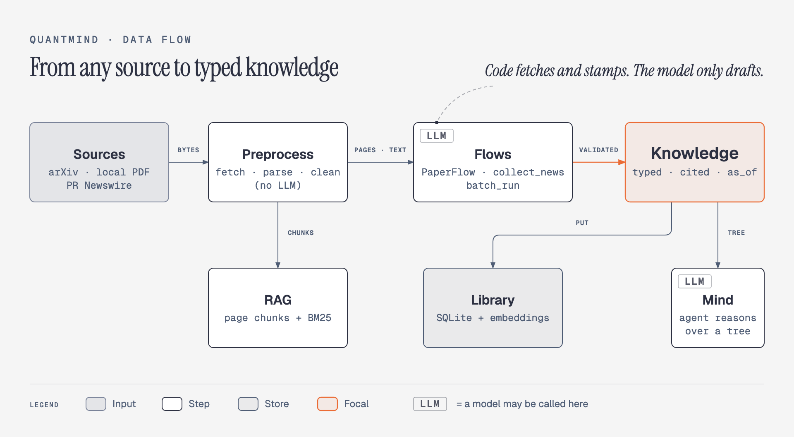
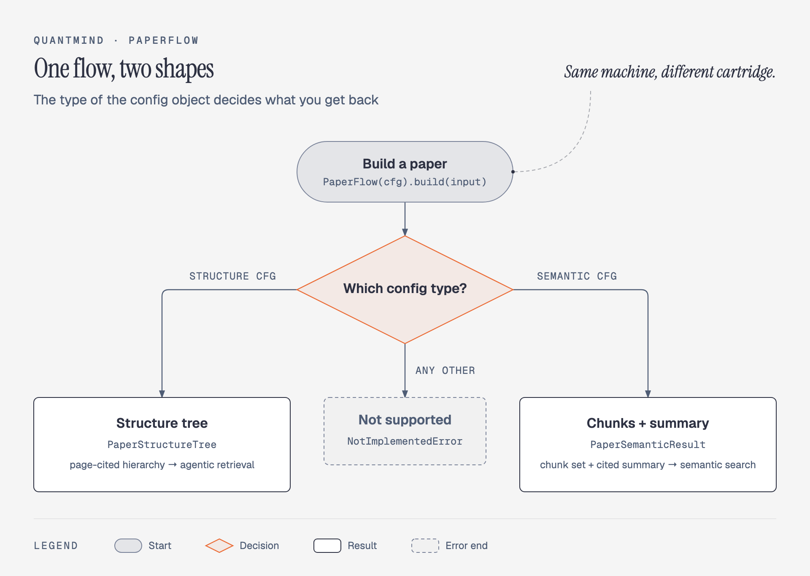
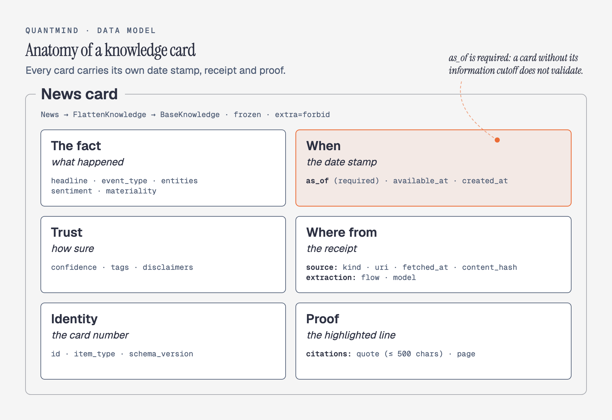
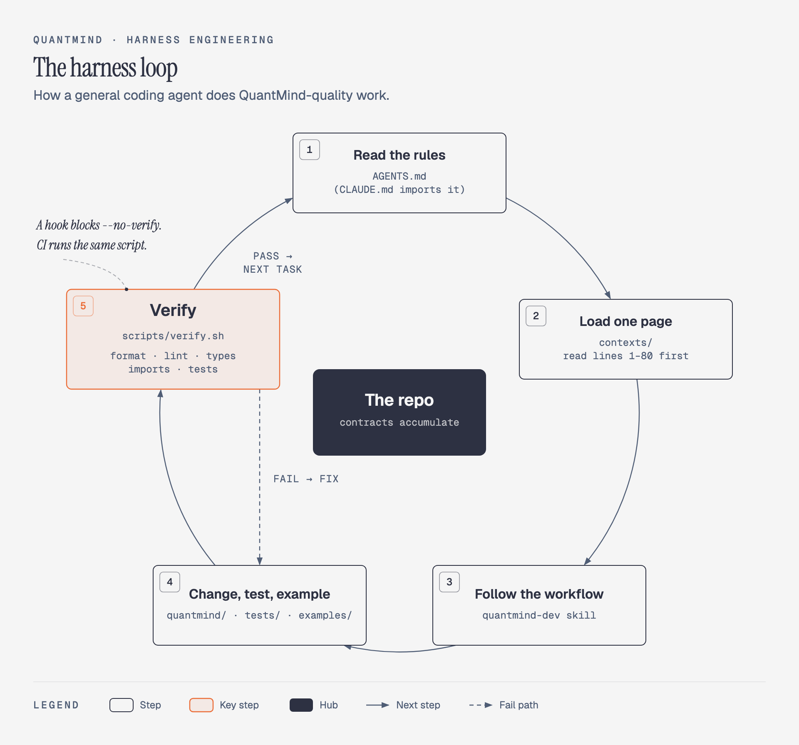

# Case Study: Design an Agent-Native Financial Knowledge Engine (QuantMind)

> **About this case study.** The chapters in this repo summarize *System Design Interview* by Alex Xu. This page is different: it applies the book's 4-step framework ([Chapter 3](../../03.%20System%20Design%20Framework/)) to a real open-source system, [LLMQuant/quant-mind](https://github.com/LLMQuant/quant-mind) (MIT license). Every claim was checked against commit `10e9dbd` (August 15, 2026). Every number marked *measured* came from running that commit on October 12, 2026.

## Introduction

QuantMind turns raw financial information (research papers, press releases, and later filings) into **typed, cited, time-stamped knowledge** that retrieval and reasoning can trust. It ships as a Python library, but its authors call it "workbench-first, library-second": the intended first move is to *open* the repository with a coding agent, not just import it. The repository is built so that the agent can work inside it and extend it safely.

> **ELI5:** QuantMind is a librarian. It photocopies the original page and writes an index card for each fact. It stamps the card with the date the fact was known, staples on a receipt saying where it came from, and files it so anyone can find it later. The library also comes with a rulebook, so a robot helper can add new shelves without breaking the old ones.

### Applications
1. **Quant research:** papers and news become structured inputs a model can cite.
2. **RAG for finance:** retrieval over knowledge that knows *when* it was true.
3. **Agent deep research:** agents read page-cited structure trees instead of raw PDFs.

### Design challenges
- **Provenance:** every fact must point back to its source text.
- **Point-in-time correctness:** a backtest must never see information from the future (look-ahead bias).
- **Reproducibility:** rebuilding the same input should produce the same artifact.
- **Model independence:** today's model will be replaced, and the pipeline should not care.
- **Extensibility by agents:** coding agents will write most new sources and flows.

---

## Step 1: Understand the Problem and Establish Design Scope

### Functional requirements
1. Ingest PDFs (arXiv, a URL, or a local file) and public company news (PR Newswire).
2. Produce typed artifacts:
   - a page-cited **structure tree** for a whole document,
   - a **chunk set with a cited summary**,
   - flat **cards** (`News`, `Earnings`, `Factor`, `Thesis`).
3. Persist artifacts locally and search them by meaning, with time filters.
4. Retrieve evidence three ways: by keyword, by meaning, and by agent reasoning.

### Non-functional requirements
- Every artifact is **self-contained**. It carries its own text, an `as_of` timestamp, and a light source reference.
- Deterministic stages are kept separate from model stages, so provenance is exact and replayable.
- The required test suite is **network-free**. Live-network checks run separately and never block unrelated changes.
- Fan-out over many inputs uses bounded concurrency.

### Shipped vs planned (commit `10e9dbd`)
| Capability | Status |
|---|---|
| `PaperFlow`: structure tree, or chunk set + cited summary | Shipped |
| `collect_news` (PR Newswire) | Shipped. Collection only: it returns source documents, not `News` cards |
| `AgenticRetriever`, `LocalKnowledgeLibrary`, page-aware BM25 | Shipped |
| Observable ETL scaffolds (`ETLPipeline`, `BatchETLPipeline`) | Shipped |
| `Earnings` card | Schema only, no flow produces it yet |
| `Factor`, `Thesis` cards | Stub schemas |
| SEC filings collection | Roadmap |
| Benchmarks (`quantmind-bench`) | In design, no numbers published |

### Back-of-the-envelope estimation
*Measured:* one 4-hour window of PR Newswire returned **48** releases with 0 failures. Of those, 9 were shareholder-litigation solicitations, 33 carried no ticker, and **6** were about a listed company.

Assume that rate holds all day. It probably does not, because this is one evening sample.
- Releases: 48 / 4 h ≈ 12 per hour ≈ **290 per day ≈ 105,000 per year**.
- Company-relevant after filtering: 6 / 48 = 12.5%, so **about 13,000 cards per year**.
- Vector storage: *measured*, a 384-dimension local embedding is stored as a 1,536-byte float32 blob. 13,000 × 1.5 KB ≈ **20 MB per year**. Carding every release would take about 160 MB per year. A 1,536-dimension embedding model multiplies both by 4.

Conclusion: a single-user knowledge base fits comfortably in one SQLite file. Scale is not the hard part of this system. **Trust** is.

---

## Step 2: Propose High-Level Design



The system is a layered pipeline. Each layer has one job. Code enforces the dependency graph between them (`import-linter` contracts in `pyproject.toml`), not convention.

| Layer | Job | Calls an LLM? |
|---|---|---|
| `preprocess` | fetch, parse, clean, normalize time | No |
| `flows` | public operations: `PaperFlow`, `collect_news`, `batch_run` | `PaperFlow` yes, `collect_news` no |
| `knowledge` | the data standard: frozen Pydantic models | No |
| `library` | persist, reopen, and search by meaning | Embeddings only |
| `rag` | page-aware chunking and BM25 | No |
| `mind` | agentic retrieval over a structure tree | Yes |
| `etl` | observable run scaffolds, standard library only | No |

Three rules from the repo's contract (`AGENTS.md`) keep the layers honest:
1. **Pipelines produce self-contained artifacts.** A flow returns a value you can use or store without a database. It never persists anything itself.
2. **The library only dumps and loads.** `put(artifact)` and `open_*` round-trip to an identical value.
3. **Mind only retrieves.** It returns evidence values with their content, not pointers you have to resolve.

### Config-bound operations



`PaperFlow(cfg).build(input)` binds an immutable config once and applies it to every input, so a batch of 100 papers runs under one fixed setting. The **type** of the config picks the output shape. `PaperStructureCfg` returns a `PaperStructureTree`, and `PaperSemanticCfg` returns a `PaperSemanticResult`. There is no hierarchy of flow classes to learn.

```python
flow = PaperFlow(PaperStructureCfg())
tree = await flow.build(ArxivIdentifier(id="1706.03762v7"))
```

> **ELI5:** one machine, different cartridges. Swap the cartridge and the same machine gives you a different kind of output.

---

## Step 3: Design Deep Dive

### 3.1 The knowledge card



Every card inherits from `BaseKnowledge`, a frozen Pydantic model with `extra="forbid"`.
- **`as_of` is required.** Financial knowledge is only useful when its information cutoff is explicit. `available_at` separately records when the source became public, so research can block look-ahead independently.
- **Provenance is typed, never a bare string.** `SourceRef` carries the source kind, URI, fetch time, and a SHA-256 of the fetched bytes, which doubles as a dedup key. `ExtractionRef` records which flow and which model produced the card.
- **Citations carry quotes** (up to 500 characters) and page numbers.

One subtle decision: for derived artifacts such as a structure tree, **provenance stays out of identity**. The artifact's `id` and `content_hash` exclude fetch time and `as_of`, so a rebuild at a different wall-clock time yields the identical artifact. *Measured:* rebuilding a structure tree from the same PDF and the same model draft produced the same tree ID.

### 3.2 The model may point; only code may stamp

This is the most important pattern in the codebase. A model never mints canonical data. It returns a **draft**, and code turns the draft into knowledge.
- **Summary:** the model returns prose plus `(chunk_index, page, quote)` coordinates. `PaperGlobalSummary.from_draft` resolves each coordinate against the real chunk set and **rejects any quote that does not appear verbatim** in the chunk text.
- **Structure tree:** the model returns titles, summaries, and page spans. `PaperStructureTree.from_draft` mints the IDs, validates the topology (exactly one root, no cycles, consistent parent and child links, page ownership), and fills each leaf with the real page text.

> **ELI5:** the model is allowed to say "the answer is on page 4, in this sentence." A clerk then opens page 4 and checks that the sentence is really there before anything gets filed.

The same pattern makes the system **model-independent**. Model calls sit behind small provider interfaces, so the model that writes a draft can change without changing anything downstream.

### 3.3 Three ways to retrieve

| | `rag` | `library` | `mind` |
|---|---|---|---|
| Finds by | keyword overlap (BM25) over page-aware chunks | meaning (embeddings), plus filters | an LLM agent reading a structure tree |
| Model needed | none | an embedding model | an LLM |
| Returns | ranked chunks with page numbers | ranked hits with source and citations | evidence nodes with page citations |
| Best for | "find the paragraph about X" in one PDF | "which companies cut guidance?" across many cards | long documents where structure matters |

The design keeps the three separate on purpose. The planned hybrid composes them, with a semantic shortlist seeding an agentic pass, instead of merging them into one retriever.

### 3.4 Point-in-time queries

`SemanticQuery` accepts `as_of_before` and `available_at_before`, and both must be timezone-aware. *Measured:* three news cards were stamped 21:51, 21:59 and 22:43 UTC. Searching with room for 10 results returned all three. Adding `as_of_before=22:00Z` returned only the first two. In a backtest, that filter is the difference between a real signal and look-ahead bias.

One nuance matters for backtests. For a revised arXiv paper, `as_of` keeps the first version's publication date, while the source revision's `available_at` records the revision date. *Measured:* version 7 of the Transformer paper was published 2017-06-12 and revised 2023-08-02. Its structure tree is stamped `as_of` 2017-06-12 and, as a derived artifact, carries no `available_at` at all. Backtests should filter on `available_at_before` where that field exists, and pin the paper version where it does not.

### 3.5 Fan-out and observability
- `batch_run(op, inputs, cfg=..., concurrency=N, on_error="skip")` runs any operation over many inputs with bounded concurrency. It returns aggregate success and failure counts.
- `ETLPipeline` and `BatchETLPipeline` write machine-readable run state (`run.json`, `events.jsonl`), and every run must choose `dry_run` explicitly when it is created. Long loops call `ctx.progress()` so the next agent can see how much work actually finished.

### 3.6 Harness engineering: the agent-native part



QuantMind's boldest claim is about the repository itself: **"a weak model in a good harness beats a strong model running bare."** The harness has five layers:
1. **Contracts:** `AGENTS.md` states the always-on rules once, and `CLAUDE.md` imports it.
2. **Progressive disclosure:** pages under `contexts/` open with a Quick Summary. Agents read lines 1 to 80 before deciding whether to load the rest.
3. **Skills:** the `quantmind-dev` skill covers setup, commits, pull requests, and component work. It is mirrored for Claude Code and Codex.
4. **Hooks:** a shared pre-tool hook blocks `--no-verify` for both agents.
5. **Deterministic verify:** `scripts/verify.sh` runs format, lint, types, import contracts, and tests with a coverage floor, in a fixed fast-fail order. CI runs the same script.

*Measured* on commit `10e9dbd`: all 5 stages green, **485 tests passed, 86% coverage** (floor 75%), with about 14 seconds of test time.

---

## Step 4: Wrap-Up

### Trade-offs and bottlenecks
- **One news source.** QuantMind collects only from PR Newswire, and most of that volume is not company news (see the estimate above). Filtering is the caller's job.
- **Closed card set.** The library stores a fixed list of card classes. That protects integrity, but a new card type needs an upstream change.
- **The search index sees only a few fields.** A `News` card is embedded as headline, event type and entities, and an `Earnings` card as ticker, period and guidance. Numbers are not semantically searchable, so numeric questions need structured queries.
- **The model hooks are private.** The provider interfaces are documented as test seams, so any code that uses them should check they still exist after each upgrade.
- **No published evaluation yet.** The harness bet is plausible but not yet measured.

### What I would add next
1. An SEC filings flow (already on the roadmap) feeding `Earnings` cards, with every number checked against a verbatim quote.
2. A public model-provider hook. Any agent, including one with no API key, could then write the draft while the same code validates it.
3. An `available_at` field on derived artifacts such as structure trees, so a revised paper cannot leak into an earlier backtest.
4. Hybrid retrieval: a semantic shortlist that seeds the agentic pass.
5. Golden test cases built from every human correction, so prompt or model changes ship only when accuracy holds.

### Try it in five minutes (no API key needed)
```bash
git clone https://github.com/LLMQuant/quant-mind.git && cd quant-mind
uv sync --extra dev --python 3.12      # the locked tiktoken has no Python 3.13 wheel
bash scripts/verify.sh                 # the full deterministic harness
uv run python examples/rag/paper.py    # page-aware BM25 over a bundled PDF
uv run python examples/flows/collect_news.py   # live PR Newswire window
```

### Key takeaways
| Idea | Why it matters in an interview |
|---|---|
| Separate deterministic stages from model stages | Provenance is exact and replayable |
| The model drafts, code stamps | Hallucinated citations cannot reach storage |
| Keep provenance out of identity | Rebuilds are reproducible, so dedup works |
| Make time a first-class field | Point-in-time queries prevent look-ahead bias |
| Enforce architecture in CI | Boundaries survive many contributors, human or agent |

## References
- QuantMind repository: <https://github.com/LLMQuant/quant-mind>
- QuantMind paper (NeurIPS 2025 GenAI in Finance workshop): <https://arxiv.org/abs/2509.21507>
- [Chapter 3: A Framework for System Design Interviews](../../03.%20System%20Design%20Framework/)
- Anthropic, [Demystifying evals for AI agents](https://www.anthropic.com/engineering/demystifying-evals-for-ai-agents), which QuantMind's evaluation design follows
